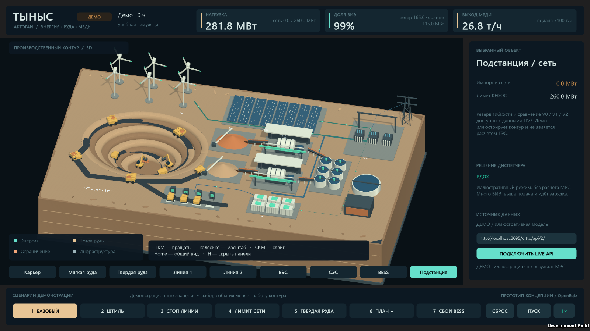

# Тыныс · Актогай — Unity-визуализация

Редактируемая 3D-сцена для проекта `shrailymadil-debug/tynys-aktogay`. Unity **6000.3.2f1**, встроенный рендерер Built-in. Геометрия и материалы созданы программно; скачивать ассеты или дополнительные пакеты не требуется.



## Открыть сцену

1. В Unity Hub выберите **Add → Add project from disk** и папку `team/tynys/unity` из этого репозитория (или `TynysUnity` из архива исходников).
2. Откройте проект в Unity **6000.3.2f1**.
3. Откройте `Assets/Tynys/Scenes/TynysMine.unity`.
4. Нажмите **Play**. По умолчанию работает автономный режим **ДЕМО**.

Сохранённая сцена содержит объекты и материалы, доступные для редактирования в Hierarchy и Inspector. Если нужно восстановить исходный макет, откройте отдельную пустую сцену и выберите **Tynys → Build editable mine scene**. Эта команда создаёт исходный макет заново и перезаписывает `TynysMine.unity`; ручные изменения в этой сцене предварительно сохраните под другим именем.

Для запуска без редактора распакуйте Windows-архив целиком и запустите `Tynys.exe`. Папка `Tynys_Data`, `UnityPlayer.dll` и остальные файлы должны оставаться рядом с EXE.

## Что показано

- Ступенчатый карьер, спиральный съезд и экскаваторы.
- 14 визуальных звеньев самосвалов: каждый двойник соответствует группе из трёх машин, как в текущей модели проекта.
- Склады мягкой и твёрдой руды, размер которых отражает заполнение.
- Две линии переработки с открытой частью крыши, мельницы и флотация.
- ВЭС, СЭС, накопитель, подстанция и зарядка флота.
- Потоки энергии, направление заряда/разряда BESS, состояние линий.
- Русская панель показателей, выбор объекта, режим «вдох/выдох».

Это **схематический макет**, а не геодезическая реконструкция Актогая. Число видимых ветряков, панелей, контейнеров и флотокамер условное. ВИЭ, BESS, электрический флот и раздельные склады относятся к гипотезе модернизации «Тыныс».

## Управление

| Действие | Управление |
|---|---|
| Вращение камеры | Правая кнопка мыши + движение |
| Сдвиг | Средняя кнопка мыши + движение |
| Масштаб | Колёсико |
| Общий вид | Home |
| Скрыть / показать интерфейс | H |
| Выбрать оборудование | Левый щелчок по объекту или кнопка под макетом |
| Переместить центр обзора к объекту | Двойной щелчок по объекту |
| Пауза демо | Пробел / кнопка |
| Скорость демо | 1× / 4× |
| Сценарии | Кнопки или клавиши 1–7 |

Сценарии: базовый, штиль, остановка линии 2, лимит сети KEGOC, твёрдая руда, план +10%, отказ BESS. «Сброс» возвращает исходные время и параметры.

## Данные действующего проекта

Сцена читает **Eclipse Ditto через существующий прокси `tynys-ui`**. Сервисы модели и координатора менять не нужно.

1. Запустите исходный проект по его README (`make up`, затем `make tynys`).
2. Убедитесь, что веб-панель открывается по `http://localhost:8095`.
3. В Unity/приложении оставьте адрес `http://localhost:8095/ditto/api/2/`.
4. Нажмите **ПОДКЛЮЧИТЬ LIVE API**.

Для другого компьютера укажите адрес доступного прокси проекта. Пароль Ditto хранится на стороне nginx; вводить его в Unity не требуется. Нельзя размещать этот прокси в публичном интернете без защиты.

Опрос выполняется раз в секунду:

```text
GET /ditto/api/2/things?ids=kz.tynys:site,...&fields=thingId,features
```

Значения читаются из `features.<имя>.properties.value`. Поддержаны 28 двойников, включая 14 звеньев транспорта; полный проект содержит дополнительные двойники. `bess.power_mw > 0` означает разряд, `< 0` — заряд. `energy.charge_mw` относится к флоту.

LIVE работает **только на чтение**. Сценарии задавайте через существующую веб-панель проекта: модель изменится через Ditto, а Unity покажет результат. Кнопки локальных сценариев в LIVE отключены.

При недоступности API до первого снимка показатели имеют вид «—». После потери соединения последний корректный снимок сохраняется с маркировкой устаревших данных. Перехода в демо без действия пользователя нет.

Для HTTP на локальной машине Windows-сборка использует Development Build. Для распространения защищённого приложения настройте HTTPS и соберите релиз; WebGL здесь не собран и отдельно требует решения вопросов CORS и доставки файлов.

## Демо и достоверность

Демо — иллюстрация реакции оборудования, **не расчёт MPC и не доказательство экономической эффективности**. В нём не показываются выдуманные результаты сравнения V0/V1/V2 и величина «Тыныс-резерва».

Использованы масштабы текущего кода проекта: ВЭС 300 МВт, СЭС 250 МВт, BESS 60 МВт / 120 МВт·ч, два склада по 200 тыс. т. На момент подготовки базовый предел сети — 260 МВт, событие KEGOC уменьшает его на 80 МВт. Это параметры сценария, а не описание существующего оборудования Актогая.

В LIVE значения полностью приходят из модели проекта. Анимация техники следует фазе цикла `route_pos` и состоянию двойника; она не является GPS-траекторией. Сцена не управляет реальным оборудованием.

## Состав исходников

| Файл | Назначение |
|---|---|
| `Assets/Tynys/Scenes/TynysMine.unity` | Сохранённая редактируемая сцена |
| `Scripts/MineWorld.cs` | Геометрия, движение, выбор объектов, потоки |
| `Scripts/MineData.cs` | Демо, HTTP-опрос, проверка и чтение JSON |
| `Scripts/MineHUD.cs` | Русский интерфейс |
| `Scripts/MineCamera.cs` | Камера |
| `Scripts/MineVerification.cs` | Проверки по явному параметру запуска |
| `Editor/TynysBuilder.cs` | Генерация сцены, проверка связей, сборка |
| `Generated/` | Сохранённые материалы и геометрия |

Пути `Scripts/`, `Editor/`, `Generated/` в таблице относительны `Assets/Tynys/`.

## Сборка и проверка

В меню **Tynys → Validate scene** проверяются связи компонентов и обязательное оборудование. **Tynys → Build Windows demo** создаёт приложение в `Builds/Windows`.

Для автоматической проверки уже собранного приложения:

```powershell
.\Tynys.exe --tynys-verify "C:\path\to\qa-results" -screen-width 1600 -screen-height 900 -screen-fullscreen 0
```

Приложение проверит сценарии, геометрию, анимацию, отсутствие сервера, сброс режимов, сохранит PNG и `verification.txt`, затем завершится. Не добавляйте этот параметр для обычного просмотра.

Проверка загрузки HTTP была выполнена на локальном снимке, полученном настоящими функциями публикации репозитория, с подменой сетевого транспорта. Это не заменяет проверку запущенного Docker-стенда команды.

## Добавить в репозиторий

Поместите содержимое этой папки в `team/tynys/unity/`. В Git должны войти `Assets` с `.meta`, `Packages`, `ProjectSettings`, `.gitignore` и этот README. `Library`, `Temp`, `Logs`, `UserSettings`, `Builds` не включаются. Архив Windows размещайте отдельно от исходников.

Основание: концепция команды из PDF и код репозитория, проверенный на коммите `14a663a`. Исходная веб-панель и сервисы не заменяются этой сценой.
